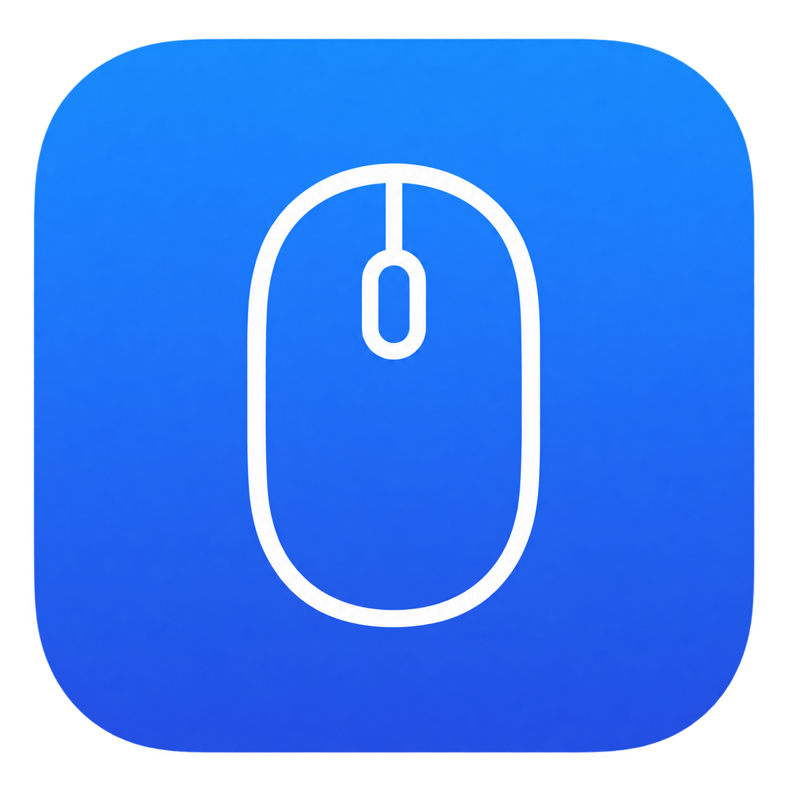

# Open Mouse



Utilitário independente de mouse para macOS. Swift, AppKit e SwiftUI. Licença MIT.

**Em desenvolvimento: a paridade completa com Mac Mouse Fix 3.1.0 ainda não foi
comprovada.** O Open Mouse não contém código ou recursos daquele aplicativo.

[Baixar a prévia 0.1.1 para Apple Silicon](https://github.com/MauricioGoulartt/open-mouse/releases/tag/v0.1.1)
· [Validação e limites](docs/VALIDATION.md)

## Implementado no código

- Rolagem suave, inércia exponencial, aceleração, velocidade, inversão independente
  e modificadores para rolagem horizontal, precisa e zoom.
- Botões 3–32: clique simples/duplo/triplo, segurar, arrastar, rolar com botão,
  modificadores de teclado e combinações de botões.
- Atalhos gravados, navegação, cliques, ações do sistema, volume, mídia e brilho.
- Gestos nativos experimentais de pinça, rotação, zoom inteligente e DockSwipe.
- Ajustes locais validados, importação/exportação, cópias de segurança, barra de
  menus opcional, execução em segundo plano e início de sessão via Service Management.
- Consulta de atualizações no GitHub ao abrir os ajustes (no máximo uma vez por dia) ou manual,
  com opção de incluir pré-lançamentos e abrir a página para download.

“Implementado” não significa validado no hardware: veja a
[matriz de paridade](docs/PARITY.md) e as [evidências de execução](docs/VALIDATION.md).
A pinça de quatro dedos usa o protocolo do Dock para Mesa e Launchpad/Aplicativos.
A equivalência dos gestos em todos os apps ainda requer validação. As atualizações
exigem download e instalação pelo usuário; não há instalador automático.
Eventos contínuos de trackpads e de dispositivos cuja identidade não pôde ser
confirmada passam intactos. Mouses de alta resolução identificados pelo IOHID
podem receber os ajustes. O aplicativo inicia desativado em uma instalação nova.

## Compilar

macOS 13 ou posterior e Swift 5.9+ (Command Line Tools ou Xcode).
O pacote do CI atual é para **Apple Silicon (arm64)**. Outros Macs podem compilar
a partir do código; isso ainda requer qualificação própria.

```bash
swift test --jobs 2
bash scripts/package-app.sh
```

O empacotamento deixa apenas `dist/OpenMouse-macOS.zip`. Instale o aplicativo
desse ZIP em `~/Applications`, mantendo uma única cópia fora do arquivo.
O parâmetro `--keep-app`, usado no CI, conserva o bundle extra para os testes.

A assinatura de desenvolvimento é ad hoc, sem notarização. Para transformar
eventos, autorize **Open Mouse** em Ajustes do Sistema → Privacidade e Segurança →
Acessibilidade e ative-o na interface. Evite executar dois remapeadores ao mesmo
tempo. Fechar a janela mantém o processamento; “Encerrar Open Mouse” o interrompe.
Ao atualizar um pacote ad hoc, o macOS pode exigir que a entrada antiga de
Acessibilidade seja removida e o aplicativo instalado seja adicionado novamente.

`OpenMouse --diagnose` informa as permissões sem iniciar captura de eventos.

## Pesquisa e contribuição

As fontes primárias e os pontos não comprovados estão em `docs/research/`.
O workflow manual **REA reference analysis** analisa uma cópia oficial do Mac
Mouse Fix 3.1.0 com REA, sem executá-la nem modificar dados do usuário.
O workflow **macOS** executa os testes, compila e empacota em runner hospedado.
Ele também exige recepção real de entrada por uma janela de teste e transições
observáveis dos gestos do sistema em um desktop descartável. Esses comandos
recusam execução fora do ambiente de teste autorizado.

Atribuições e licença de código permissivo adaptado:
[THIRD_PARTY_NOTICES.md](THIRD_PARTY_NOTICES.md).
